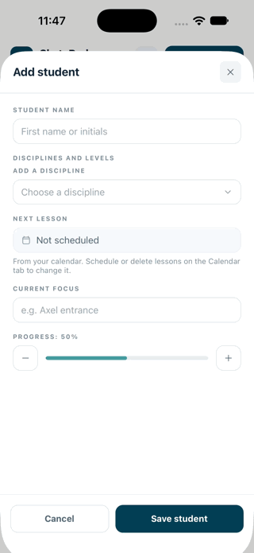

# ⛸️ SkatePod

> *Because your love is on the ice, not the shuffle.*

SkatePod is a coach-first app for figure skating coaches: one home for each student's lesson notes, practice checklist, music and program files, and competition links, so coaches spend less time hunting for details and more time teaching.

**Status:** Early stage personal project (discovery and prototyping). Not yet released.

<p align="center">
  
</p>

*Demo (iOS Simulator, made-up sample data): add a student with a discipline, schedule a lesson, then build their program and drag a spin into skating order.*

## Vision

Skating away from endless juggling of details, so coaches can be on the ice teaching.

## Who it's for

1. **Coaches at our home rink** who teach private lessons (first users)
2. **Their students**, starting with a read-only share link
3. **Later:** coaches at other Atlanta-area rinks

## Strategies

- **Coach-experience centric**, because existing apps are mostly built around skaters or billing.
- **Keep it simple and organized**, because coaches have many students to manage.
- **Work alongside existing tools** (Google Drive, Skater Stats), because coaches already have habits, which makes adoption easier.

## What coaches told us

In an October 2026 survey of 9 coaches, scheduling and admin was the most common frustration (6 of 9), finding competition and test rules was what most wanted fixed (4 of 9), and 7 of 9 keep student information mostly in their head. Charts and takeaways: [research/survey-2026-10](research/survey-2026-10/README.md).

## MVP scope

**In:** student list · quick lesson notes (newest first) · practice checklist · links to Drive files, music and competition documents · read-only share link

**Not now:** live competition-requirements lookup · payments and invoicing · skater accounts · wearables · hosting music files

## What's in this repo

| Folder | What it is |
| --- | --- |
| [`mobile/`](mobile/) | **The iPhone app** (Expo, React Native + TypeScript). Android-ready later. |
| [`backend/`](backend/) | **REST API** (Spring Boot 4 + PostgreSQL): students, weekly lessons, training notes, programs and availability, matching the app's model, with DTOs, validation and Flyway migrations. Not connected to the app yet. |
| [`research/`](research/) | Coach research, like the [October 2026 survey](research/survey-2026-10/README.md). |
| [`prototype/figma-make/`](prototype/figma-make/) | Original web prototype from Figma Make (React + Vite + Tailwind). Kept as a design reference. |

## Run it locally

The app and the backend run separately, so use one Terminal tab for each. The app doesn't talk to the backend yet: it uses sample data stored on the phone.

### One-time setup (Mac)

Backend: Java 21, Maven and Docker Desktop. Steps are in [`backend/README.md`](backend/README.md#one-time-setup-mac).

iPhone app: Node.js LTS, plus Expo Go on your iPhone:

```bash
cd mobile
sh setup.sh        # installs Expo and matching packages
npx expo login     # same account as Expo Go
```

### Every time

**Tab 1: backend**

1. Open **Docker Desktop** and wait until it says it's running.
2. Start the database and the API:

```bash
cd backend
docker compose up -d       # start PostgreSQL
./mvnw spring-boot:run     # API on http://localhost:8080/api
```

Leave it running. Check it at http://localhost:8080/api/students, or use the **SkatePod** collection in Postman.

**Tab 2: iPhone app**

```bash
cd mobile
npx expo start             # scan the QR code with your iPhone camera
```

Your Mac and iPhone need to be on the same Wi-Fi. If the phone can't connect, use `npx expo start --tunnel`. More details are in [`mobile/README.md`](mobile/README.md).

### Stopping

- App or API: press **Ctrl+C** in its tab.
- Database: `cd backend && docker compose down`. Add `-v` to wipe its data and get the original sample data back on the next start.

## Run the web prototype

```bash
cd prototype/figma-make
npm install
npm run dev
```

## Roadmap

- [x] Customer discovery survey for coaches
- [x] Competitive analysis and product strategy
- [x] Paper sketches and Figma Make prototype
- [ ] Review survey results and talk with coaches
- [x] Port the Figma Make prototype to an Expo iPhone app
- [ ] Try it on a real iPhone and fix what feels off
- [ ] Trim to the coach MVP based on survey results
- [ ] Test with home-rink coaches via TestFlight
- [x] Backend scaffold: Spring Boot + PostgreSQL (students, lessons)
- [x] Feature #2: next lesson from the calendar
- [x] Backend matches the app: weekly lessons, training notes, programs, availability
- [ ] Connect the app to the backend, then add share links
- [ ] Launch (free) on the App Store

## Privacy

Many skaters are minors. SkatePod keeps student data minimal (first names or initials) and never needs student accounts in the MVP.
