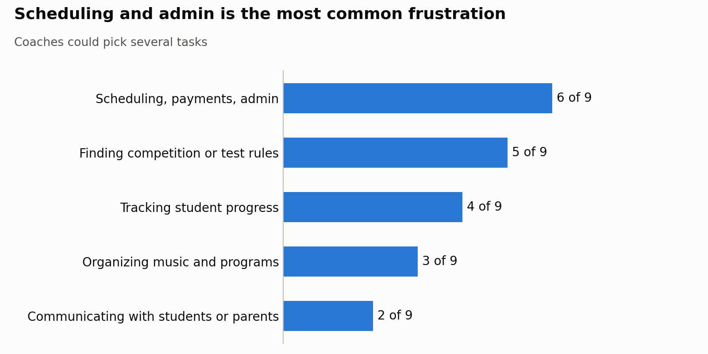
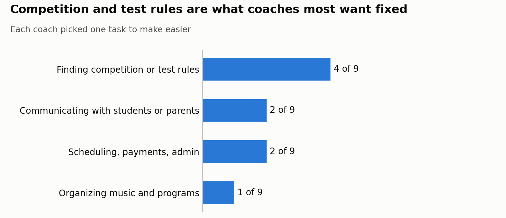
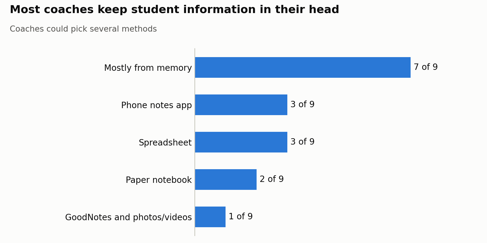

# Coach survey, October 2026

A short survey of **9 figure skating coaches** about what slows them down off the ice.
Only totals are kept here: no names or answers from any one coach.

## What we learned

**1. Scheduling and admin is the most common frustration** (coaches could pick several).
Scheduling, payments and admin: 6 of 9. Finding competition or test rules: 5. Tracking student progress: 4. Organizing music and programs: 3. Communicating with students or parents: 2.

**2. Competition and test rules are what coaches most want fixed** (each coach picked one).
Finding competition or test rules: 4 of 9. Communicating with students or parents: 2. Scheduling, payments and admin: 2. Organizing music and programs: 1.

**3. Most coaches keep student information in their head** (coaches could pick several).
Mostly from memory: 7 of 9. Phone notes app: 3. Spreadsheet: 3. Paper notebook: 2. GoodNotes and photos or videos: 1.

## What it means for SkatePod

- **Calendar first.** Scheduling is the pain most coaches share, which backs the weekly lesson calendar.
- **Lesson notes replace memory.** Seven of nine coaches rely on memory, so quick notes after each lesson (the Lessons tab) fill a real gap.
- **Link to the rules, don't copy them.** Rules are the top "fix this" pick. The Programs tab links to the official U.S. Figure Skating charts; a live rules lookup stays out of the MVP.
- **Music and programs matter, but less.** Worth having (the Programs tab), not the headline.

Nine coaches is a small group, so read these as signals, not proof.
